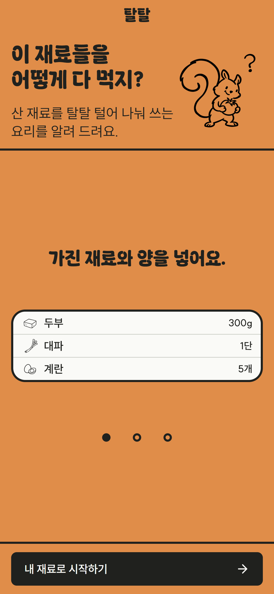
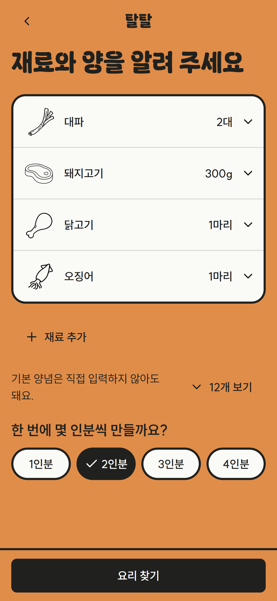
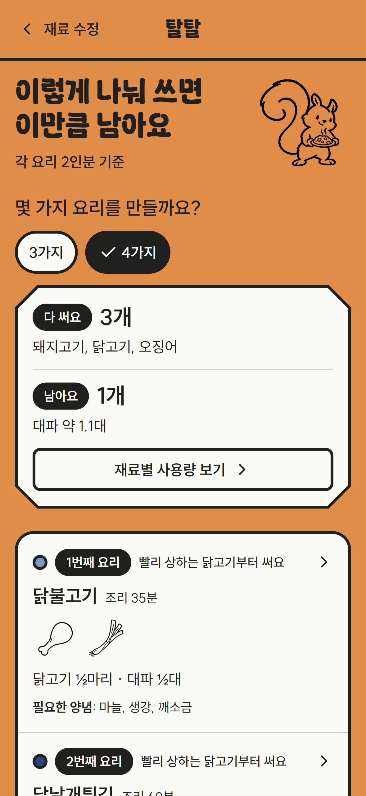
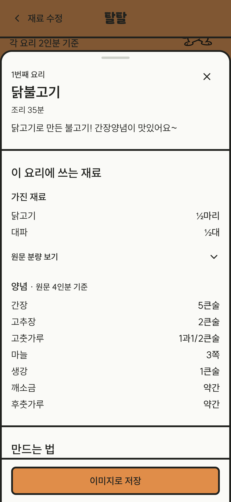

# 탈탈

> 이 재료들을 어떻게 다 먹지? 산 재료를 탈탈 털어 나눠 쓰는 요리를 알려 드려요.

탈탈은 장을 보고 직접 요리하는 사람이 산 재료와 양을 넣으면, 그 재료를 여러 요리에 나눠 쓰는 3~5가지 요리 묶음을 추천하는 모바일 웹 서비스입니다.

- 서비스 주소: https://taltal.vercel.app

## 따라 해 보기

아래 순서로 써 볼 수 있습니다.

1. 소개 화면에서 "내 재료로 시작하기"를 누릅니다. 소개는 첫 방문에만 나오고, 3일 안에 다시 오면 시작 홈으로 바로 갑니다.
2. 시작 홈에서 "직접 고르기"를 누릅니다.
3. 재료 고르기 시트에서 산 재료를 검색해 여러 개 고르고 "N개 담기"를 누릅니다. 예를 들어 대파, 돼지고기, 닭고기, 오징어를 고릅니다. 간장 같은 양념은 고르지 않아도 됩니다.
4. 재료마다 "양 고르기"를 눌러 가진 양과 단위를 정합니다. 예에서는 대파 2대, 돼지고기 300g, 닭고기 1마리, 오징어 1마리입니다. 목록에 없는 양은 "직접 입력"으로 넣습니다.
5. "한 번에 몇 인분씩 만들까요?"에서 인분을 고르고 "요리 찾기"를 누릅니다. 예에서는 2인분을 고릅니다.
6. 추천 결과 화면 위쪽에서 다 쓰는 재료와 남는 재료를 봅니다. 그 아래 요리 카드는 빨리 상하는 재료를 쓰는 요리부터 "N번째 요리" 순서로 나옵니다.
7. "몇 가지 요리를 만들까요?"의 탭으로 가짓수를 바꿔 봅니다. 가짓수를 늘려도 덜 남지 않으면 그 탭은 나오지 않습니다.
8. 요리 목록 아래에 "조금 사서 더 써 볼까요?"가 나오면 "조금 사는 요리 보기"를 눌러 재료를 조금 사서 더 쓰는 묶음을 봅니다. 이 제안은 조금 사는 쪽이 덜 남을 때만 나옵니다.
9. "재료별 사용량 보기"를 누르면 재료마다 어느 요리에 얼마나 쓰고 얼마나 남는지 봅니다.
10. 요리 카드를 누르면 레시피 상세 시트에서 재료와 조리 과정을 봅니다. "이미지로 저장"을 누르면 그 요리를 PNG로 저장합니다.

결과 화면에서 "재료 수정"을 누르면 입력한 재료를 그대로 둔 채 재료 입력으로 돌아갑니다. 입력한 재료는 저장하지 않으므로 새로고침하면 처음부터 다시 입력합니다.

| 소개 | 재료 입력 | 추천 결과 | 레시피 상세 |
| --- | --- | --- | --- |
|  |  |  |  |

## 로컬에서 실행하기

Node.js 24에서 실행합니다. 배포 빌드도 Node.js 24를 씁니다.

```bash
git clone https://github.com/uyeon0/taltal.git
cd taltal
npm ci
npm run dev
```

브라우저에서 http://localhost:3000 을 엽니다.

레시피 데이터는 비공개 저장소에 있어 이 저장소에는 들어 있지 않습니다. 그래서 저장소만 받아 실행하면 소개와 시작 홈은 열리지만, 재료 입력과 추천 결과 화면은 재료 데이터를 읽지 못해 오류가 나고 API는 500 오류를 돌려줍니다. 데이터 저장소에 접근할 수 있으면 JSON 파일 세 개를 `data/app/`에 두거나 `APP_DATA_DIR` 환경 변수로 그 폴더를 지정합니다.

| 환경 변수 | 용도 | 없을 때 |
| --- | --- | --- |
| `APP_DATA_DIR` | 앱 데이터 폴더. 로컬과 테스트에서만 씁니다 | `data/app/`을 읽습니다 |
| `NEXT_PUBLIC_CLARITY_PROJECT_ID` | Microsoft Clarity 프로젝트 ID | Clarity 스크립트를 불러오지 않습니다 |

## 테스트와 점검

```bash
npm test           # Vitest
npm run lint       # ESLint. FSD 의존 규칙도 여기서 검사합니다
npm run typecheck  # Next.js 라우트 타입을 만든 뒤 tsc로 검사합니다
```

테스트는 대부분 테스트 파일 안에서 만든 가짜 재료와 레시피로 돕니다.

## 다른 앱과 다른 점

1. 요리 묶음 하나를 추천합니다. 레시피를 한 개씩 늘어놓지 않고, 산 재료를 여러 요리에 나눠 쓰는 묶음 하나를 보여 줍니다.
2. 남는 양을 보여 줍니다. 요리마다 쓴 양을 빼고, 묶음이 끝나면 어떤 재료가 얼마나 남는지 보여 줍니다.
3. 빨리 상하는 재료부터 씁니다. 빨리 상하는 재료를 쓰는 요리를 앞 순서에 두고, 왜 먼저인지 적습니다.

사람들은 재료를 묶음으로 사지만 요리는 일주일에 한두 번 합니다. 산 재료를 다 쓰려면 며칠에 걸쳐 여러 요리에 나눠 써야 하는데, 레시피 검색은 한 번에 한 요리만 보여 주므로 나눠 쓰는 계획은 사람이 머릿속으로 세워야 합니다. 그 사이 빨리 상하는 채소가 먼저 버려집니다. 설문 응답 35건 중 요리하는 31명의 74%(23명)가 최근 한 달 안에 재료를 버렸습니다. 표본이 작고 치우쳤을 수 있어 전체 사용자를 대표하지는 않습니다.

## 화면 흐름

```text
[소개] ──▶ [시작 홈] ──직접 고르기──▶ [재료 입력] ──요리 찾기──▶ (계산 중) ──▶ [추천 결과]
 첫 방문만                                 ▲  │                     │              │
                                           │  └▶ 재료 선택 시트      │              ├▶ 사용량 시트
                                           │                        ▼              └▶ 레시피 상세 시트
                                           └──────────────── 오류, 추천 없음, 재료 수정
```

화면은 소개, 시작 홈, 재료 입력, 추천 결과 네 개입니다. 재료 선택, 사용량, 레시피 상세는 바텀시트로 엽니다.

## 추천 로직

추천은 두 단계로 나뉩니다. 후보 고르기는 서버에서, 묶음 고르기는 브라우저에서 합니다.

```text
[브라우저] 가진 재료와 양(g), 인분 ──POST /api/candidates──▶ [서버] filterCandidates: 후보 레시피 최대 30개
[브라우저] recommend: 후보에서 3·4·5가지 묶음을 고릅니다 (Web Worker)
```

1. 화면은 사용자가 고른 수량에 재료별 단위 g을 곱해 g으로 바꿉니다.
2. 서버의 `filterCandidates`는 가진 재료를 쓰고, 가진 양 안에서 쓰고, 혼자서도 3가지를 넘게 사지 않는 레시피만 남겨 최대 30개를 돌려줍니다. 레시피 전체를 브라우저로 보내지 않기 위해서입니다.
3. 브라우저의 `recommend`는 후보로 만들 수 있는 묶음을 모두 살펴 남는 양 점수가 가장 낮은 묶음을 고릅니다. 남는 양 점수는 재료마다 남은 비율에 보관 등급 가중치(빨리 상함 3, 보통 1.5, 오래 감 1)를 곱해 더한 값입니다. g 합으로 세면 무거운 재료만 줄이고 가벼운 채소를 남기는 묶음이 뽑히기 때문입니다.
4. 사지 않는 묶음과 조금 사는 묶음(3가지까지 구매)을 같은 후보로 각각 구합니다.
5. 가짓수를 늘려도 남는 양 점수가 줄지 않으면 그 가짓수는 보여 주지 않습니다.
6. 고른 요리는 가진 재료 중 가장 빨리 상하는 등급이 높은 요리부터 순서를 매깁니다.

묶음 계산은 화면 입력을 멈추지 않게 Web Worker에서 돌립니다. 레시피 상세는 사용자가 연 요리 하나만 `GET /api/recipes/[id]`로 받습니다. 자세한 규칙은 `docs/data-contract.md`에 있습니다.

## 기술 구성

| 구분 | 쓰는 것 |
| --- | --- |
| 프레임워크 | Next.js 16(App Router), React 19, TypeScript |
| 화면 | Tailwind CSS 4, shadcn/ui(Radix UI), vaul(바텀시트), Embla Carousel |
| 상태 | zustand |
| 테스트 | Vitest, Testing Library, jsdom |
| 코드 검사 | ESLint, Prettier, husky와 lint-staged |
| 배포 | GitHub Actions, Vercel |
| 사용 기록 | Microsoft Clarity(유저 테스트용) |

## 구조

코드는 [Feature-Sliced Design](https://feature-sliced.design/)(FSD)을 따릅니다. Next.js의 `app/`은 루트에 두고 라우트 파일만 담습니다. FSD 코드는 `src/`에 둡니다.

```text
app/                  Next.js 라우트. _pages, _app에서 가져온 것을 내보내기만 합니다
proxy.ts              첫 방문이면 /에서 /intro로 보냅니다
src/
├── _app/             앱 전체 설정. 레이아웃, 스타일, 폰트, 서버 API 처리 함수, Clarity
├── _pages/           화면. intro, home, ingredients, results
├── widgets/          화면의 큰 덩어리. 재료 목록, 결과 요약, 요리 카드 목록, 사용량 시트, 레시피 상세 시트
├── features/         사용자 동작. build-inventory(재료 입력), find-meals(추천)
├── entities/         도메인 데이터와 규칙. ingredient, recipe
└── shared/           도메인과 무관한 공통 코드. UI, 요청 함수, JSON 읽기, 화면 문구
```

모듈은 `_app → _pages → widgets → features → entities → shared` 방향으로 자기보다 아래 층만 가져옵니다. 같은 층의 다른 슬라이스는 가져오지 않고, 슬라이스 밖에서는 공개 API(`index.ts`)로만 가져옵니다. 서버에서만 쓰는 코드는 `*.server.ts`에 두고 `index.server.ts`로 내보냅니다. 이 규칙은 ESLint로 강제하며, 어기면 lint가 실패합니다.

FSD의 `app`, `pages` 층은 Next.js 폴더 이름과 겹치지 않게 `_app`, `_pages`로 씁니다. 자세한 내용은 `docs/architecture.md`에 있습니다.

## 데이터

레시피는 농림축산식품 공공데이터 포털의 레시피 데이터를 정리해 만듭니다. 앱은 빌드한 JSON 세 개를 읽기만 합니다.

| 파일 | 내용 |
| --- | --- |
| `ingredients.json` | 입력할 수 있는 재료와 양념, 단위별 g |
| `recipes.json` | 추천에 쓰는 레시피와 1인분 재료 g |
| `recipe-steps.json` | 레시피별 요약과 조리 과정 |

이 파일들은 비공개 저장소에 있고, 이 저장소에는 커밋하지 않습니다.

## 배포

`main`에 push하면 GitHub Actions가 비공개 저장소에서 앱 데이터를 받아 `data/app/`에 넣고, Vercel CLI로 빌드해 프로덕션에 배포합니다.
